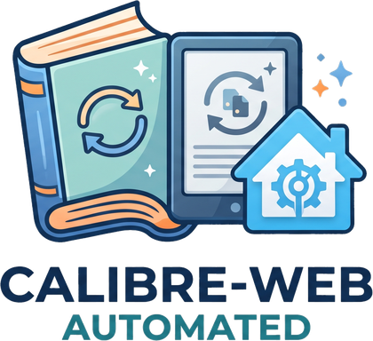

  

# Home Assistant Add-on: Calibre-Web Automated

[Calibre-Web Automated][cwa] packaged as a Home Assistant add-on: a modern web
e-book library with automatic ingest and conversion, metadata enforcement,
OPDS and Kobo Sync, with your books stored in `/share` or `/media`.

## Installation

1. Click the button above, or in Home Assistant go to
   **Settings → Add-ons → Add-on Store → ⋮ → Repositories** and add
   `https://github.com/NicholasMantovani/ha-calibre-web-automated`.
2. Find **Calibre-Web Automated** in the store and click **Install**. The
   add-on is built locally on top of the official upstream image, so the first
   installation downloads about 1 GB.
3. Review the **Configuration** tab (library and ingest paths, PUID/PGID,
   timezone), then **Start** the add-on.
4. Click **Open Web UI** and log in with `admin` / `admin123`. Change the
   password right away.

The full documentation is in the add-on's **Documentation** tab
([DOCS.md](calibre-web-automated/DOCS.md)).

## Add-ons in this repository

| Add-on | Description |
| ------ | ----------- |
| [Calibre-Web Automated](calibre-web-automated/) | Web e-book library with auto-ingest, conversion, OPDS and Kobo Sync |

## How it works

- **Base image:** the official `crocodilestick/calibre-web-automated` image
  (tag pinned in [`build.yaml`](calibre-web-automated/build.yaml)), with a
  thin Home Assistant layer on top.
- **Startup:** an s6-overlay v3 oneshot (`init-ha-setup`) runs before the
  LinuxServer.io / CWA init chain. It reads `/data/options.json`, exports
  `PUID`/`PGID`/`TZ`, and bind-mounts:
  - `/data/cwa-config` → `/config` (persistent app settings)
  - `library_path` → `/calibre-library`
  - `ingest_path` → `/cwa-book-ingest` (bind mount, so inotify works)
- **Privileges:** `SYS_ADMIN` and AppArmor disabled, needed only for the bind
  mounts.

## Automatic updates

The [`sync-upstream`](.github/workflows/sync-upstream.yml) workflow runs every
Monday at 06:00 UTC (and on demand). When a new upstream release is published
**and** its Docker image is available for amd64 and arm64, it:

1. updates `version` in `config.yaml` (with the `v` prefix removed);
2. updates the image tag in `build.yaml` and `Dockerfile`;
3. adds an entry to `CHANGELOG.md` linking the upstream release notes;
4. commits and pushes to `main`;
5. publishes a GitHub release `v<version>` with the changelog entry as notes.

Home Assistant then shows the update in the add-on store.

## Releases

The [`release`](.github/workflows/release.yml) workflow publishes a GitHub
release for the version in `config.yaml` whenever `main` changes (and is
called by `sync-upstream` after an automatic bump). It is idempotent: if the
release `v<version>` already exists, nothing happens. To release a manual
change, bump `version` in `config.yaml`, add a `## <version>` section to
`CHANGELOG.md` and push to `main`.

> Commits pushed with the default `GITHUB_TOKEN` do not trigger other
> workflows, so `lint.yml` does not run on those automatic commits. If `main`
> is branch-protected, allow `github-actions[bot]` to push or use a PAT.

## Maintainer notes

- To ship add-on-only fixes between upstream releases, bump the version with a
  suffix (for example `4.0.8-1`) so Home Assistant offers the update.

## License

The add-on packaging in this repository is released under the
[MIT License](LICENSE). Calibre-Web Automated itself is licensed under
GPL-3.0 by its authors.

[cwa]: https://github.com/crocodilestick/Calibre-Web-Automated
